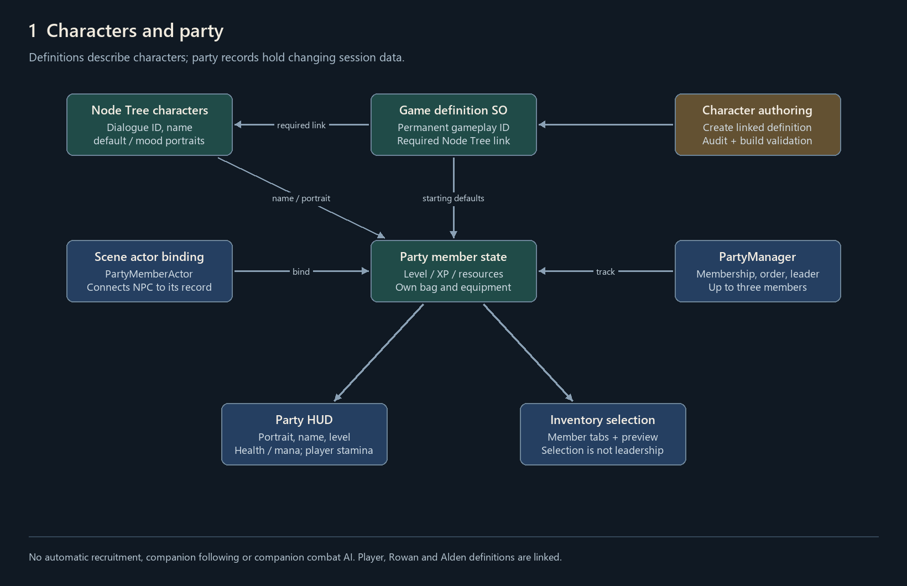
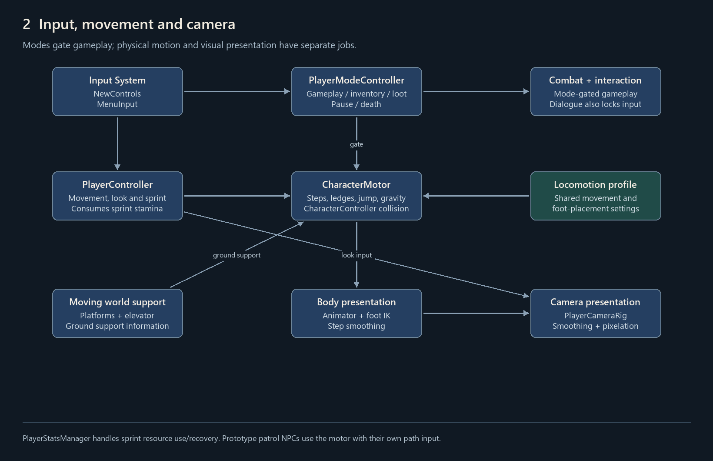
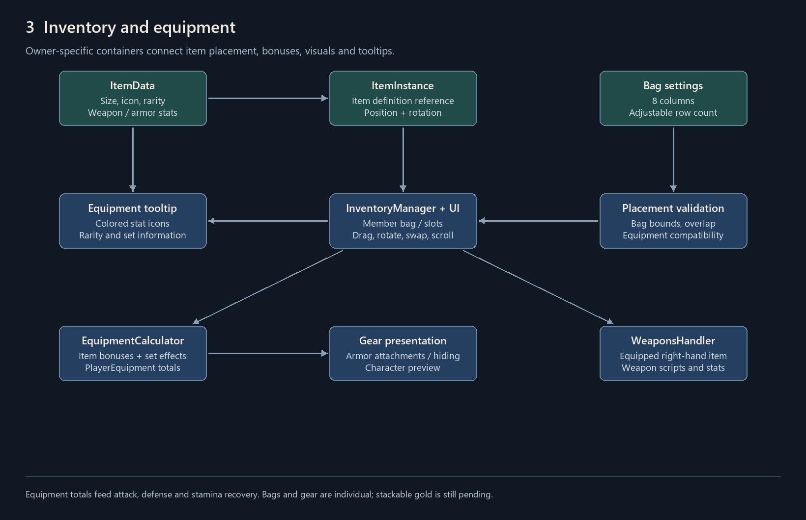
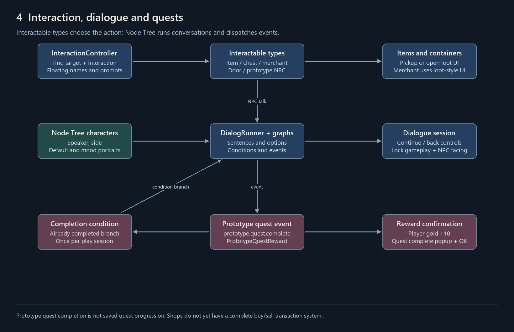
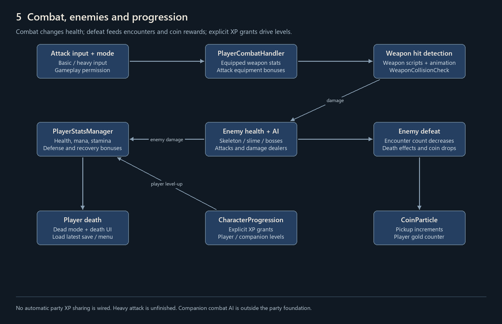
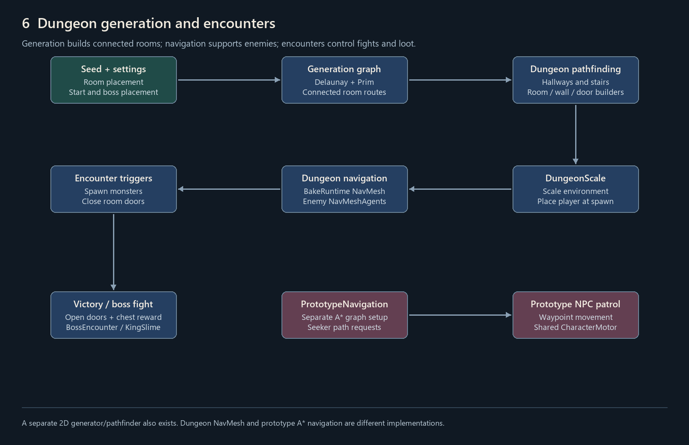
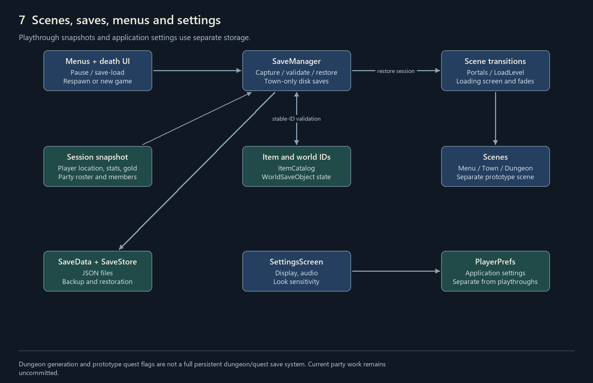

# Current system map

Source-level map of the current implementation, 2026-10-23. Connections describe code dependencies/data flow, not proof of Play Mode verification. Prototype and incomplete behavior is called out explicitly.

## 1. Character definitions and party

Node Tree supplies dialogue identity and appearance; the game definition supplies a permanent gameplay identity and starting defaults, while party records hold changing state.

Party membership does not drive companion following or combat AI. Player, Rowan and Alden definitions exist, but companions are not automatically recruited.

## 2. Input, movement and presentation

Input and player modes gate gameplay; the motor handles physical movement while animation, step smoothing, feet and camera present it.

Sprint consumes stamina through PlayerStatsManager. Prototype patrol NPCs also use CharacterMotor, but use their own pathfinding/input logic.

## 3. Inventory, equipment and tooltips

Inventory views request changes from InventoryManager; equipped items feed both gameplay bonuses and visible armor/weapon presentation.

Player and companions own separate bags/equipment. Gold-to-stackable-item conversion has not been implemented.

## 4. Interaction, dialogue and prototype quests

The interaction controller finds an interactable; its type determines whether it talks, picks up an item, opens a container, or operates a door.

Merchants currently use the loot UI rather than a complete buy/sell transaction system. The prototype quest flag is not part of SaveData.

## 5. Combat, enemies and progression

Weapons and equipment bonuses determine outgoing damage; enemies damage player stats, and defeated enemies update encounters and produce coin pickups.

There is no automatic party XP distribution wired here. Heavy attack is still an empty handler, and companion combat AI is outside the party implementation.

## 6. Dungeon generation and navigation

The dungeon generator lays out connected rooms and passages; runtime setup bakes navigation, then encounters manage fights, locked doors and rewards.

The project also contains a separate 2D generator/pathfinding implementation. Prototype A* navigation and dungeon NavMesh navigation are separate paths.

## 7. Scenes, saves, menus and settings

Scene transitions preserve the session, while SaveManager snapshots it to disk and restores character/item/world state through stable IDs.

Disk saves are currently Town-only. Settings are stored separately from playthrough saves. Dungeon generation state and prototype quest completion are not a general persistent quest/dungeon save system.

